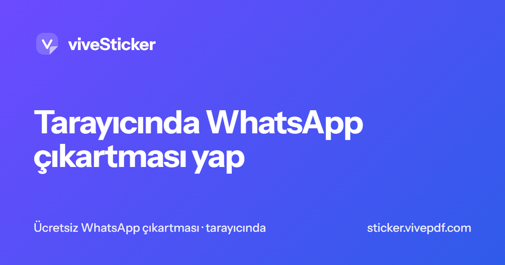

<div align="center">


# viveSticker

**Her fotoğraftan, GIF'ten ve videodan WhatsApp çıkartması, kendi cihazında.**

Tarayıcıda çalışan ücretsiz ve açık kaynak bir çıkartma yapıcı. Çıkartmaları kırp, arka planını sil, kes, süsle ve WhatsApp sınırlarına uyan paketler hâline getir; dosyaların hiçbir yere yüklenmez.

[English](README.md) · **Türkçe**

[Web sitesi](https://sticker.vivepdf.com/) · [WhatsApp'a ekleme](https://sticker.vivepdf.com/whatsapp-cikartma-ekleme) · [Çıkartma boyutları](https://sticker.vivepdf.com/whatsapp-cikartma-boyutlari) · [SSS](https://sticker.vivepdf.com/sss) · [Tartışmalar](https://github.com/mtvrkan/viveSticker/discussions)

[](https://github.com/mtvrkan/viveSticker/actions/workflows/ci.yml)
[](LICENSE)




</div>

## Neden viveSticker

- **Hiçbir şey cihazından çıkmaz.** Dönüştürme, arka plan silme ve paket hazırlama tarayıcıda yapılır. Hesap yok, kullanım verisi toplanmaz, hiçbir şey yüklenmez.
- **WhatsApp kurallarına göre yapıldı.** Her çıkartma 512×512 olur ve boyut ile süre sınırlarının altına kendiliğinden indirilir; ilk denemede kabul edilir.
- **Ücretsiz ve açık.** MIT lisanslı, bir kez açıldıktan sonra internetsiz çalışır ve uygulama gibi ana ekrana yüklenebilir.

## Özellikler

- **İçe aktar:** Fotoğraf, GIF, hareketli WebP/PNG ya da videoyu sürükle, seç, yapıştır veya bağlantısını ver; X (Twitter) gönderi bağlantıları da olur. Android'de yüklü uygulamaya başka bir uygulamadan dosya paylaşabilirsin.
- **Kırp ve yerleştir:** 512×512 tuvalde dikdörtgen (her oran, yuvarlak köşe), daire, kalp, yıldız, konuşma balonu ya da yumuşak kenarlı serbest kesim. Sıkıştırarak yakınlaştırma, sürükleme, döndürme, ortaya yapışma, geri al/yinele ve basılı tutunca karşılaştırma.
- **Hareketi kes:** Zaman çizelgesinde başlangıç ve bitişi seç, hızı değiştir (0,5×–2×) ve bir videodan birkaç aralık kes; her biri ayrı çıkartma olur.
- **Arka planı sil:** Cihazda çalışan yapay zekâyla fotoğrafta tutmak istediğin nesnelere dokun ya da GIF ve videonun her karesinde insanları kes.
- **Süsle:** Dış çizgi, dört stilde yazı, emoji ve serbest çizim.
- **WhatsApp sınırlarına kendiliğinden uy:** Durağan çıkartmalar 100 KB'ın altında kalır (mümkünse kayıpsız), hareketliler önce kalite sonra kare hızı düşürülerek 500 KB ve 10 saniyenin altına iner. İstersen kaliteyi elle de ayarlayabilirsin.
- **Kitaplık ve paketler:** Yaptığın her çıkartma cihazında saklanır. _Paketlerim_ sayfasında aynı türden 3–30 tanesini seç, pakete ad ver ve 96×96 tepsi simgesiyle `.wastickers` dosyasını indir.
- **Arayüz** Türkçe (`/`) ve İngilizce (`/en/`); her çıkartma yöntemi için bir rehber sayfası, header'da araçlar menüsü ve sisteme uyan açık ve koyu tema.

## Çıkartmaları WhatsApp'a ekleme

WhatsApp, web sitelerinin çıkartma paketlerini doğrudan eklemesine izin vermiyor.

- **Tek çıkartma:** WebP dosyasını indir ve WhatsApp çıkartma dosyası kabul eden bir uygulama ya da araçla kullan.
- **Paket:** `.wastickers` dosyasını indir ve bir çıkartma içe aktarma uygulamasıyla aç. Bu uygulamalar çoğunlukla Android'de var.

[Adım adım rehber](https://sticker.vivepdf.com/whatsapp-cikartma-ekleme) ikisini de anlatıyor.

## Kullanılan WhatsApp sınırları

|                    | Sınır                                        |
| ------------------ | -------------------------------------------- |
| Boyut              | 512×512 px                                   |
| Durağan çıkartma   | ≤ 100 KB                                     |
| Hareketli çıkartma | ≤ 500 KB, ≤ 10 sn, kareler ≥ 8 ms            |
| Tepsi simgesi      | 96×96 PNG, ≤ 50 KB                           |
| Paket              | 3–30 çıkartma, durağan ve hareketli karışmaz |

## Gizlilik

- Görseller, videolar ve çıkartmalar cihazından hiç çıkmaz.
- Kitaplığın tarayıcının IndexedDB deposunda durur. Site verilerini silmek onu da siler.
- Yazı tipleri ve arka plan silme modelleri sitenin kendisinden gelir; üçüncü taraf yazı tipi ya da analiz isteği yapılmaz. Bağlantıdan medya almak, girdiğin siteye bağlanır. X (Twitter) gönderi bağlantılarında medya dosyasını bulmak için gönderi kimliği herkese açık FxTwitter API'sine gönderilir; dosya ardından X'in medya sunucularından indirilir.

## Geliştirme

Yığın: SvelteKit (statik) · Svelte 5 · Tailwind CSS v4 · TypeScript · WebAssembly'ye derlenmiş libwebp ve MediaPipe.

Gerekenler: Node 22.18+ ve pnpm.

```sh
pnpm install
pnpm dev
```

Testler: `pnpm test` (birim) · `pnpm check` · `pnpm lint` · `pnpm test:e2e` (telefon, tablet ve masaüstünde Chromium ve WebKit; bir kez `pnpm exec playwright install chromium webkit` çalıştır). `pnpm build` statik siteyi derler, `pnpm og` bir sayfa başlığı değişince `static/og` altındaki Open Graph kartlarını yeniden çizer.

## Web sitesi

https://sticker.vivepdf.com adresindeki site bu repo; adapter-static ile tamamen statik derlenir.

- Rotalar: `src/routes/[[lang=lang]]/` (ana sayfa), `…/pack` (Paketlerim) ve `…/[slug=page]` (rehber sayfaları). Türkçe kökte, İngilizce `/en/` altında; dili adres belirler.
- Sayfa metinleri `src/lib/content/tr.ts` ve `en.ts` içinde; adresler, site URL'si ve sayfa kimlikleri `src/lib/seo/site.ts` içinde.
- Her sayfa kendi başlığını, açıklamasını, kanonik adresini, `hreflang` alternatiflerini, Open Graph kartını ve JSON-LD'sini üretir. `sitemap.xml` ve `robots.txt` derleme sırasında oluşur.

`.github/workflows/ci.yml` her pull request'te ve `main`'e her push'ta kontrol, lint, biçim, birim testleri, derleme ve tarayıcı testlerini çalıştırır. `scripts/deploy-site.sh` siteyi GitHub Pages için `gh-pages` branch'ine derler; yayınlamak için `--push` ekle. Alan adı `static/CNAME` içinde; `BASE_PATH`'i yalnızca site bir alt yoldan sunulacaksa ayarla.

## Katkı ve destek

Hata bildirimleri [Issues](https://github.com/mtvrkan/viveSticker/issues)'a, sorular ve fikirler [Tartışmalar](https://github.com/mtvrkan/viveSticker/discussions)'a. Pull request'ler memnuniyetle karşılanır; göndermeden önce yukarıdaki testleri çalıştır. Güvenlik sorunlarını lütfen herkese açık issue yerine [gizli olarak bildir](https://github.com/mtvrkan/viveSticker/security/advisories/new).

## Lisans

MIT — bkz. [LICENSE](LICENSE). Üçüncü taraf bileşenler:

| Bileşen                                                                                                             | Lisans                           |
| ------------------------------------------------------------------------------------------------------------------- | -------------------------------- |
| [@jsquash/webp](https://github.com/jamsinclair/jSquash) (WebAssembly'ye derlenmiş libwebp)                          | Apache-2.0, libwebp BSD-3-Clause |
| [MediaPipe Tasks Vision](https://github.com/google-ai-edge/mediapipe) ve Magic Touch ile Selfie Segmenter modelleri | Apache-2.0                       |
| Fontsource üzerinden Instrument Sans, JetBrains Mono, Anton ve Caveat                                               | SIL Open Font License 1.1        |
| SvelteKit, Svelte, Vite, Tailwind CSS                                                                               | MIT                              |
